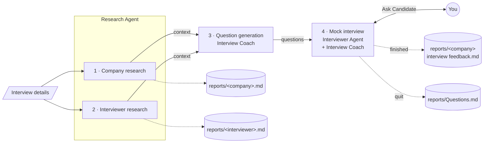
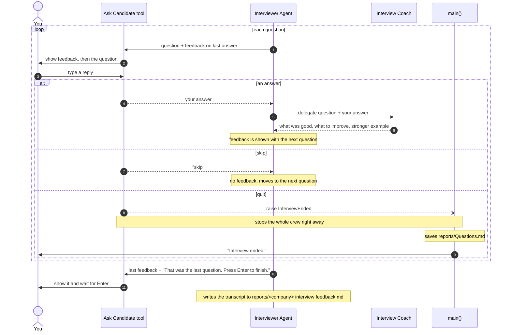

# Job Interviewer

A multi-agent mock interview app built with [CrewAI](https://www.crewai.com/). You give it the interviewer's name and role, the company, the job title and the job description. The app then:

1. researches the company and the interviewer on the web,
2. writes a large set of open-ended questions that this interviewer would realistically ask, based on their role,
3. runs a **live mock interview in your terminal**, asking one question at a time and giving you feedback on each answer before the next question.

The agents run the whole flow in a single CrewAI run. The only Python the agents use is a small tool for talking to you in the terminal.

## System Design

One **sequential crew** runs three agents across four tasks. You enter the interview details (interviewer, their role, company, job title and job description). The Research Agent then searches and scrapes the web for tasks 1 and 2, which feed task 3 as context, and task 3's question list feeds task 4. Tasks 1–3 need no input from you.



### The interview loop

During task 4, the Interviewer Agent asks every question through the **Ask Candidate** tool. What happens next depends on what you type:



| You type | Handled by | What happens | Files written |
|----------|------------|--------------|---------------|
| an answer | Interviewer Agent | The coach reviews your answer. You see the feedback above the next question. | none until the end |
| `skip` | Interviewer Agent, following its task instructions | The question gets no feedback and the next one is asked straight away. The question still appears in the transcript. | none until the end |
| `quit` | Ask Candidate tool and `main()`, in code | The tool raises `InterviewEnded`. This is a `BaseException`, so neither the agent nor CrewAI's tool error handling catches it, and the crew stops at once. `main()` catches it, prints *Interview ended.* and saves the full question list. | `reports/Questions.md`, but no interview feedback file |
| *(after the last question)* Enter | Interviewer Agent | The interview task finishes and writes the full transcript with an overall summary. | `reports/<company> interview feedback.md` |

The research reports from tasks 1 and 2 are written before the interview starts, so you keep them however the interview ends.

### Agents

| Agent | What it does | Model | Tools |
|-------|--------------|-------|-------|
| **Research Agent** | Researches the company (sector, trends, news from the last 12 months) and the interviewer's career | `gpt-4o` | `SerperDevTool` (Google search via Serper), `ScrapeWebsiteTool` |
| **Interview Coach** | Writes the question set, then reviews each of your answers during the interview | `gpt-4o` at `temperature=1.0` | none |
| **Interviewer Agent** | Plays the interviewer you named and runs the mock interview | `gpt-4o` | `Ask Candidate`, plus CrewAI's delegation tools (`allow_delegation=True`) |

### Tasks

1. **Company research**: the company's position in its sector, industry trends, and news and developments from the last 12 months. Saved to `reports/<company>.md`.
2. **Interviewer research**: the interviewer's professional career, in the context of the role and company you entered. Saved to `reports/<interviewer>.md`.
3. **Question generation**: the Interview Coach writes a numbered list of **100** open-ended questions, as the interviewer would ask them. The questions are shaped by the interviewer's role:
   - **Technical interviewers** (engineers, staff or principal engineers, architects, tech leads) ask hands-on questions about the tools and systems in the job description: design trade-offs, incidents, debugging, scaling and security.
   - **Managers and directors** ask about delivery, prioritisation, ownership, working with other teams and handling ambiguity.
   - **Recruiters, HR and people partners** ask about motivation, culture fit, career path and ways of working.

   Questions use realistic scenarios ("Walk me through…", "How would you design…", "Tell me about a time…"), never yes/no questions. Under each question is a *"What a strong answer covers:"* note. Each run gets a random session seed and the coach runs at temperature `1.0`, so you get a different set of questions every time.
4. **Mock interview**: for each question, the Interviewer Agent:
   1. asks it in its own voice with the **Ask Candidate** tool, without showing you the *"What a strong answer covers"* notes,
   2. delegates your exact answer to the **Interview Coach**, who says what was good, what could be improved and how to take the answer further, and gives a short example of a stronger answer,
   3. shows you that feedback just before the next question.

   When the interview finishes, the full transcript is saved to `reports/<company> interview feedback.md`. It has every question, your answer, the feedback, and an overall summary of your strengths and what to improve.

### The Ask Candidate tool

`AskCandidateTool` is a small CrewAI `BaseTool` that lets the Interviewer Agent talk to you. Each time the agent calls it, the tool:

- prints the coach's feedback on your previous answer, if there is one,
- prints the next question,
- reads your answer from the terminal and returns it to the agent.

If you type `quit`, the tool raises `InterviewEnded`. This is a `BaseException`, not an `Exception`, so CrewAI's tool error handling doesn't catch it. The run stops right away instead of the agent carrying on.

## Requirements

- Python **3.13** (pinned in `.python-version`; `pyproject.toml` requires `>=3.13,<3.14`)
- [uv](https://docs.astral.sh/uv/) (recommended) or pip
- An **OpenAI API key** with access to `gpt-4o`
- A **Serper API key** for web search (free tier at [serper.dev](https://serper.dev))

### Dependencies

| Package | Version |
|---------|---------|
| `crewai` | 1.15.22 |
| `crewai-tools` | 1.15.22 |
| `langchain-openai` | 1.6.6 |

Exact versions are locked in `uv.lock`.

## Setup

### 1. Install

With uv:

```bash
cd crewai_job_interviewer
uv sync
```

With pip:

```bash
python3.13 -m venv .venv
source .venv/bin/activate
pip install -e .
```

### 2. Set environment variables

| Variable | Purpose |
|----------|---------|
| `OPENAI_API_KEY_AI_AGENTS` | Your OpenAI API key. The app copies it into `OPENAI_API_KEY` at startup. |
| `SERPER_API_KEY` | Your Serper API key, used by `SerperDevTool`. |

> **Note:** The OpenAI key is read from `OPENAI_API_KEY_AI_AGENTS`, not the usual `OPENAI_API_KEY`, so this project can use a separate key from your other tools. If either variable isn't set, the app exits with a `KeyError` before asking for any input.

Add them to your shell profile (e.g. `~/.zshrc`):

```bash
export OPENAI_API_KEY_AI_AGENTS="sk-..."
export SERPER_API_KEY="your-serper-key"
```

Then reload your shell with `source ~/.zshrc`.

## Usage

Run the app with either of these commands:

```bash
uv run interview      # console script defined in pyproject.toml
# or
uv run python main.py
```

### 1. Enter the interview details

```
Enter the name of the interviewer: Jane Doe
Enter the role of the interviewer: Staff Software Engineer
Enter the name of the company: Acme Corp
Enter the job position: Senior Data Engineer
Enter the job description: <paste the job description on a single line>

### Agent running...
```

> **Tip:** Each prompt reads **one line**, so paste the job description without line breaks. `readline` is imported, so you can use the arrow keys to edit what you've typed.

The interviewer's role matters most: it decides what kind of questions you get (see [Tasks](#tasks)).

### 2. Wait for research and question writing

The first three tasks run without any input from you, and can take a few minutes. `verbose` is `False` by default, so the terminal stays quiet during this time. To watch the agents search, scrape and think, set `verbose = True` on the `Crew` in `main.py`.

### 3. Take the interview

```
Question: Walk me through how you'd design Acme's event ingestion pipeline to handle a 10x traffic spike...

> I'd start by putting a queue in front of the consumers...

Feedback:

**What was good:** ...
**What could be improved:** ...
**Next level:** ...

Question: Tell me about a time you had to debug a data quality issue in production...

>
```

| Type | What happens |
|------|--------------|
| your answer, then Enter | The answer is sent to the coach. You see the feedback with the next question. |
| `skip` | Moves to the next question without feedback. |
| `quit` | Ends the interview straight away and saves the full question list (see below). |

Answers are **one line**: pressing Enter submits the answer.

After the last question, the agent shows the feedback on your final answer and asks you to press Enter to finish.

## Output

All files are written to `reports/`, which is listed in `.gitignore`:

| File | When it's written |
|------|-------------------|
| `reports/<company>.md` | After the company research task |
| `reports/<interviewer>.md` | After the interviewer research task |
| `reports/<company> interview feedback.md` | When the interview finishes: the full transcript with feedback and an overall summary |
| `reports/Questions.md` | When you type `quit`: all the generated questions, with the *"What a strong answer covers"* notes |

> **Note:** The interview feedback file is only written when the interview task finishes. If you `quit`, it isn't created. You keep the research reports and `Questions.md` instead. If you finish all the questions, `Questions.md` isn't written, but the transcript has every question you were asked.

## Configuration

All settings are in `main.py`:

| Setting | Default | What it controls |
|---------|---------|------------------|
| `number_of_questions` | `100` | How many questions the coach writes and the interviewer asks. Also sets the Interviewer Agent's `max_iter` (`number_of_questions * 4`), because each question takes several agent steps. |
| `questions_file` | `reports/Questions.md` | Where the question list is saved when you quit |
| `question_llm` | `LLM(model="gpt-4o", temperature=1.0)` | The Interview Coach's model. The high temperature makes each run's questions different. |
| `llm` | `ChatOpenAI(model="gpt-4o", temperature=0.5)` | The model for the Research and Interviewer agents. Only `llm.model_name` is passed to them, so CrewAI uses its default temperature, not `0.5`. To set it, pass a `crewai.LLM(...)` object, as `question_llm` does. |
| `verbose` on `Crew` | `False` | Set to `True` to see each agent's reasoning and tool calls |
| Research window | last 12 months | In `research_company_task.description` |
| Output file names | see [Output](#output) | The `output_file` on each task |

**Tip:** 100 questions make for a very long interview. For a 30–45 minute practice session, set `number_of_questions` to around `10`–`15`.

## Project structure

```
crewai_job_interviewer/
├── main.py            # tool, agents, tasks, crew and entry point
├── pyproject.toml     # project metadata, dependencies and the `interview` script
├── uv.lock            # locked dependency versions
├── .python-version    # Python 3.13
├── .gitignore         # ignores reports/, .venv and __pycache__
└── README.md
```

### Inside `main.py`

| Name | What it is |
|------|------------|
| `InterviewEnded` | `BaseException` raised when you type `quit` |
| `AskCandidateInput` / `AskCandidateTool` | The tool's input schema (`question`, `feedback_on_previous_answer`) and the terminal tool |
| `research_agent`, `coach_agent`, `interviewer_agent` | The three agents |
| `research_company_task`, `research_interviewer_task`, `questions_task`, `interview_task` | The four tasks, run in order |
| `crew` | The sequential crew that runs everything |
| `write_questions_file()` | Saves the generated questions to `Questions.md` when you quit |
| `main()` | Starts the crew and handles `quit` |

> The interview details are asked for, and the agents are built, when `main.py` is loaded, not inside `main()`. Importing the module therefore asks for input straight away.

## Limitations

- **The agent controls the interview loop.** The order (ask, get feedback, next question) depends on the Interviewer Agent following its instructions. With a long run, it may sometimes skip feedback, reword or merge questions, or stop early. If that happens, lower `number_of_questions` or tighten the wording in `interview_task.description`.
- **Cost and context grow with the interview.** Every answer and every piece of feedback stays in the Interviewer Agent's context, so later questions cost more tokens. A full 100-question interview uses a lot of tokens.
- **Answers are one line.** Long answers have to be typed or pasted without line breaks.
- **Research quality depends on what's online.** Little-known interviewers, or sites that block scraping, can make the research thin. The questions still use the job description and the interviewer's role.

## Troubleshooting

| Problem | Fix |
|---------|-----|
| `KeyError: 'OPENAI_API_KEY_AI_AGENTS'` | Export the variable (see [Setup](#2-set-environment-variables)). |
| `KeyError: 'SERPER_API_KEY'` | Export your Serper key. |
| Python version error during install | Use Python 3.13 (`uv python install 3.13`). |
| Nothing happens after `### Agent running...` | The research and question tasks are running quietly. Wait a few minutes, or set `verbose = True` to watch them. |
| The interview stops before all questions are asked | The agent hit its step limit or lost its place. Lower `number_of_questions`, or raise `max_iter` on `interviewer_agent`. |
| Thin or out-of-date research | Check your Serper quota. Some sites block `ScrapeWebsiteTool`. |
| Odd file names in `reports/` | Report files are named exactly after your input, so avoid `/` and other special characters in company or interviewer names. |
