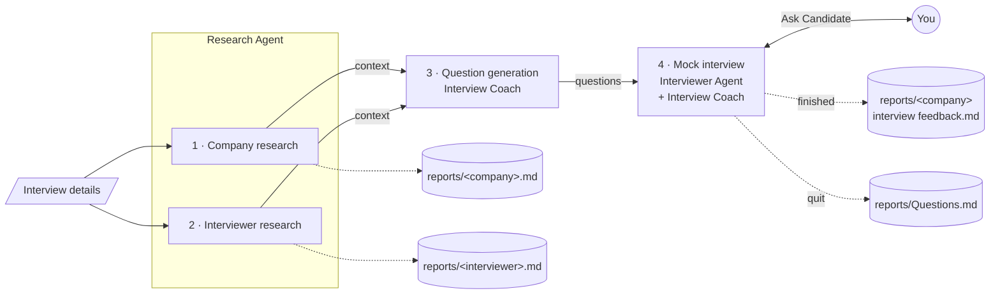
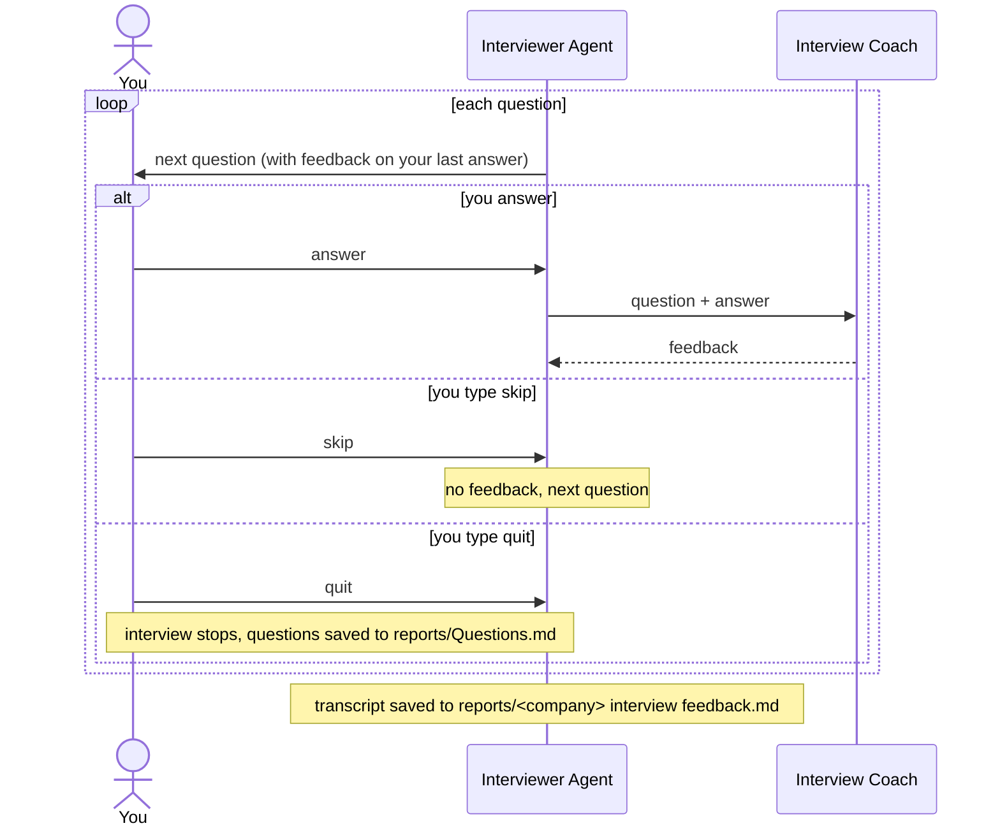

# Job Interviewer

A mock interview app built with [CrewAI](https://www.crewai.com/). Tell it who's interviewing you and for what job. It researches the company and the interviewer, writes the questions that interviewer would likely ask, and interviews you in the terminal, giving feedback on each answer.

## How it works



| Agent | Job |
|-------|-----|
| **Research Agent** | Searches the web (Serper) and scrapes pages to research the company and the interviewer |
| **Interview Coach** | Writes the questions, then gives feedback on each of your answers |
| **Interviewer Agent** | Plays the interviewer and asks you the questions one at a time |

The questions match the interviewer's role: a technical interviewer asks hands-on technical questions, a manager asks about delivery and teamwork, and a recruiter asks about motivation and culture fit. You get a new set of questions every run.

### The interview loop



## Setup

You need Python 3.13, [uv](https://docs.astral.sh/uv/), an [OpenAI](https://platform.openai.com/) API key and a [Serper](https://serper.dev) API key (free tier available).

```bash
uv sync

export OPENAI_API_KEY_AI_AGENTS="sk-..."   # note: not OPENAI_API_KEY
export SERPER_API_KEY="your-serper-key"
```

Add the `export` lines to `~/.zshrc` so you don't have to set them each time.

## Usage

```bash
uv run interview
```

Enter the interview details. Each prompt takes one line, so paste the job description without line breaks:

```
Enter the name of the interviewer: Jane Doe
Enter the role of the interviewer: Staff Software Engineer
Enter the name of the company: Acme Corp
Enter the job position: Senior Data Engineer
Enter the job description: ...
```

Research and question writing take a few minutes with no output. Then the interview starts:

```
Question: Walk me through how you'd design Acme's event pipeline to handle a 10x traffic spike...

> I'd start by putting a queue in front of the consumers...
```

| Type | To |
|------|----|
| your answer + Enter | get feedback, then the next question |
| `skip` | move on without feedback |
| `quit` | stop the interview |

## Output

Everything is saved in `reports/`:

| File | Contents |
|------|----------|
| `<company>.md` | Company research |
| `<interviewer>.md` | Interviewer research |
| `<company> interview feedback.md` | Full transcript with feedback. Only written if you finish the interview. |
| `Questions.md` | All the generated questions. Only written if you `quit`. |

## Configuration

These settings are in `main.py`:

- `number_of_questions` (default `100`): how many questions you're asked. Try `10`–`15` for a 30–45 minute session.
- `verbose` on the `Crew` (default `False`): set it to `True` to watch the agents work.

## Troubleshooting

| Problem | Fix |
|---------|-----|
| `KeyError` on startup | One of the two API key variables isn't set. |
| No output after `### Agent running...` | That's normal: research takes a few minutes. Set `verbose = True` to watch it. |
| The interview stops early or skips feedback | The agent lost its place on a long run. Lower `number_of_questions`. |
